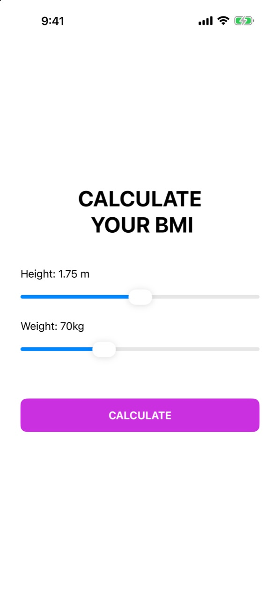
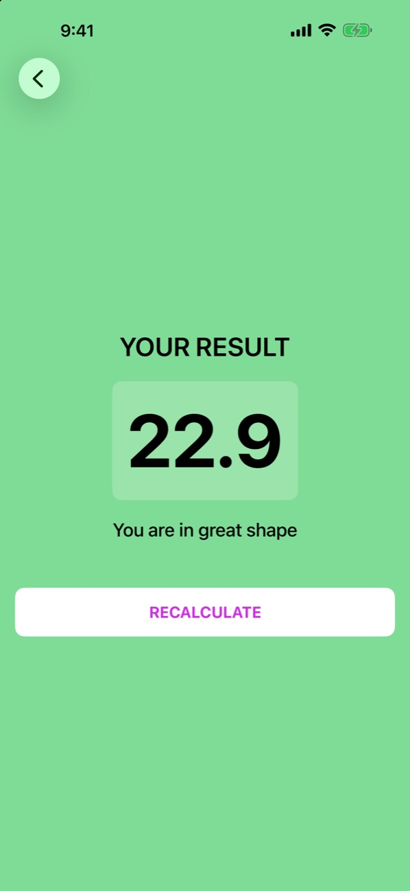
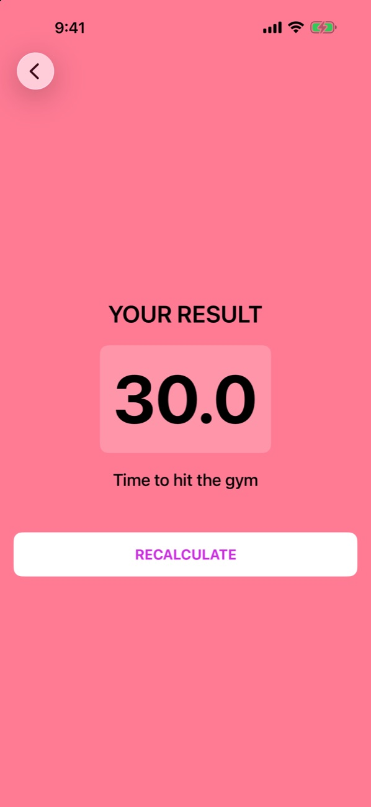

# BMI Calculator

**Slide, tap, know. A clean SwiftUI app that turns your height and weight into a BMI score and a friendly verdict.**

&nbsp;&nbsp;
&nbsp;&nbsp;

---

## What it does

No keyboards and no unit confusion. Drag two sliders to set your height (1.0–2.5 m) and weight (30–150 kg), tap **Calculate**, and a full-screen result card slides in. It shows your BMI to one decimal place in a colour that tells you where you stand at a glance.

## Highlights

- **Slider-first input.** Height is precise to the millimetre and weight to the kilogram, with live labels as you drag.
- **Colour-coded verdicts.**
  - 🟡 Under 18.5: *"Go, get some M&M"*
  - 🟢 18.5–24.9: *"You are in great shape"*
  - 🔴 25 and over: *"Time to hit the gym"*
- **Big, bold result.** An 80-pt score on a frosted card, easy to read in one glance.
- **One-tap recalculate.** Jump straight back to the sliders and try again.

## How it's built

| Layer | File | Role |
|---|---|---|
| Model | `Model/BMI.swift` | Value type holding the score, the advice and the theme colour |
| ViewModel | `ViewModel/BMICalculatorViewModel.swift` | `ObservableObject` that owns the slider state and runs the BMI formula (`weight / height²`) |
| Views | `View/ContentView.swift`, `View/ResultView.swift` | Input screen with sliders, and a result screen pushed with `NavigationStack` |

## Getting started

1. Clone the repo and open `BMI_App.xcodeproj` in Xcode.
2. Choose an iPhone simulator and press **⌘R**.

## About

Built by **Roszhan Raj** while learning SwiftUI and MVVM.
